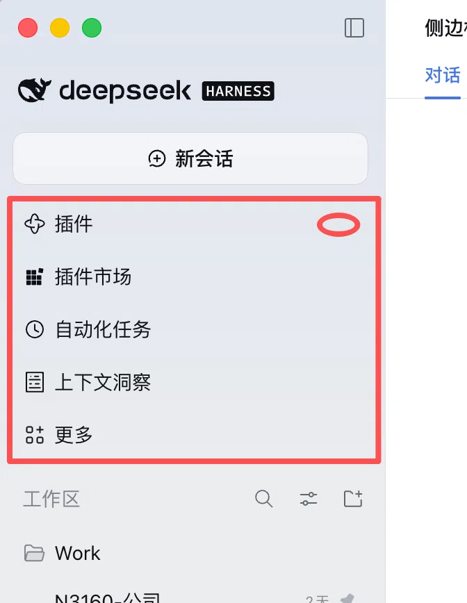

# dsh-sidebar-plugins-toggle

> A DeepSeekRuntime (DSH) plugin: adds a small chevron at the right edge of the **Plugins** row in the
> sidebar. Click it to collapse the plugins area, click again to expand it.

**Display name: Collapse Sidebar** (中文名「收起侧边栏」) — DSH reads it from `locale/en.json` and
`locale/zh.json` (`meta.title`), so the plugin list shows this instead of the package id.



<sub>Red box = the plugins area this plugin collapses. Red circle = where the chevron goes.</sub>

The "plugins area" is the block of sidebar entries at the top: **plugin market, automation tasks,
context insights, More**. Collapsing it keeps only the **Plugins** row and gives the vertical space
back to the session list.

## Behaviour

| Expanded (default) | Collapsed |
| --- | --- |
| `▣ Plugins ▾` + plugin market / automation / context / More | `▣ Plugins ▸` only |

- The **Plugins** row always stays: otherwise the chevron would collapse with it and there would be
  no way back.
- The collapsed state is persisted in `localStorage` (`dsh-sidebar-plugins-toggle:collapsed`).
- In the 56px icon rail the chevron hides itself and **nothing** is collapsed — a collapsed rail with
  no chevron would be a dead end.
- Clicking the chevron never opens the Plugins panel as a side effect (the event is intercepted in
  the capture phase).
- Tooltip text covers the 8 locales DSH ships; Tab + Enter/Space work too.
- Re-renders, whole-row replacement, locale switches and panel re-registration all re-align
  automatically; if the sidebar cannot be found, the plugin does nothing and throws nothing.

## Install

Verified against DSH `0.2.2-rc.1`.

```bash
cd ~/.dsh/profiles/desktop        # your actual profile directory
pnpm add github:Hanice404/dsh-sidebar-plugins-toggle
```

Then add it to `dsh.profile.bundles` in the same `package.json`:

```json
{
  "dsh": {
    "profile": {
      "bundles": ["…", "dsh-sidebar-plugins-toggle"]
    }
  }
}
```

Reload the page once (the refresh button in the DSH header, or reopen the app) and the chevron
appears.

For local development, `pnpm add "link:/absolute/path/to/dsh-sidebar-plugins-toggle"` picks up code
changes on the next reload.

## Uninstall

Remove `dsh-sidebar-plugins-toggle` from `dsh.profile.bundles`, then
`pnpm remove dsh-sidebar-plugins-toggle`.

## Why DOM decoration

Each sidebar row is rendered solely by `@deepseek-ai/dsh-client-ui-sidebar`. A row exposes only the
`sidebar.panellist` icon slot and its title text — there is **no slot for a trailing row action**. So
the plugin decorates the row instead of patching an official package:

| Step | How |
| --- | --- |
| Locate | Anchor on `[data-sidebar-toggle]`, walk up, then down to the first `nav[aria-label]` (the global panel list) |
| Identify | Read the `plugins` entry's own label from `ctx.slots.entriesOfSlot('sidebar.panellist')` (locale-aware), fall back to an 8-locale word list |
| Mount | Append `<span data-dsh-pst-host>` to the row button and draw the chevron as plain DOM (no React, so it cannot fight the row's children reconciliation) |
| Collapse | Tag every direct child of the `nav` except the Plugins row with `data-dsh-pst-hidden` (CSS `display:none!important`); the More menu anchor lives at the same level and collapses with them |
| Maintain | `MutationObserver` coalesced into one microtask per round |
| Teardown | Remove nodes, styles, `data-dsh-pst-*` attributes and the observer |

The host half (`index.js`) is an empty carrier: the desktop shell treats a failed startup entry as
fatal, so the safest host half is no host half.

## Test

```bash
npm test          # 25 end-to-end checks in a real Chrome/Chromium
CHROME_BIN=/path/to/chrome npm test   # when Chrome is not on PATH
```

The suite renders a DOM isomorphic to the official sidebar and checks mounting position, the default
expanded state, collapsing leaving only the anchor row, not hijacking the row click, label/direction,
`localStorage` persistence, rail mode, self-healing after a whole-row replacement, keyboard support,
and a clean teardown.

## License

[MIT](LICENSE) © 2026 小黑 (Hanice404)
