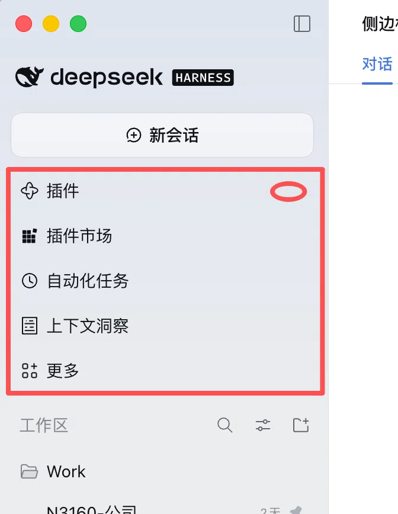

# dsh-sidebar-plugins-toggle

> DeepSeekRuntime（DSH）插件：在侧边栏「插件」那一行的最右侧加一个小箭头 —— 点一下**收起插件区**，再点一下**展开**。

**显示名：收起侧边栏**（DSH 的插件列表 / 插件页里显示的就是这个名字；英文名 `Collapse Sidebar`，来自 `locale/zh.json`、`locale/en.json` 的 `meta.title`）。



<sub>红框 = 本插件收起的「插件区」，红圈 = 箭头的位置。</sub>

「插件区」指侧边栏顶部那一块入口：**插件市场 / 自动化任务 / 上下文洞察 / 更多**。
收起后只留「插件」这一行，把竖向空间还给会话列表。

## 效果

**展开（默认）**

```
🐟 deepseek HARNESS
＋ 新会话
▣  插件                    ▾   ← 点这里
▣  插件市场
⏱  自动化任务
▤  上下文洞察
⊞  更多
── 工作区 ──
```

**收起**

```
🐟 deepseek HARNESS
＋ 新会话
▣  插件                    ▸   ← 再点一下展开
── 工作区 ──
```

## 特性

- **只收不动的**：「插件」这一行永远保留，否则箭头会跟着消失、就没法点回来了。
- **记得住**：折叠状态存在 `localStorage`（`dsh-sidebar-plugins-toggle:collapsed`），刷新页面后保持。
- **轨道模式不折叠**：侧栏折成 56px 图标轨道时箭头自动隐藏，并且不收起任何入口（轨道里没有箭头，收起会变成死路）。
- **不抢点击**：点箭头不会顺带打开「插件」面板 —— 事件在捕获阶段就被拦下。
- **跟随语言**：提示文案覆盖 DSH 支持的 8 种语言，Tab + Enter/空格 也能操作。
- **不会画花界面**：React 重渲染、整行被替换、切换语言、面板重新注册后都会自动重新对齐；找不到侧边栏就什么都不做，不抛错。

## 安装

先确认你的 DSH 版本是 `0.2.2-rc.1`（本插件按该版本侧边栏结构验证过）。

```bash
cd ~/.dsh/profiles/desktop        # 换成你实际使用的 profile 目录
pnpm add github:Hanice404/dsh-sidebar-plugins-toggle
```

然后把它加进同一个目录下 `package.json` 的 `dsh.profile.bundles`：

```json
{
  "dsh": {
    "profile": {
      "bundles": [
        "…",
        "dsh-sidebar-plugins-toggle"
      ]
    }
  }
}
```

**刷新一次页面**（DSH 右上角的刷新按钮，或重新打开应用），箭头就出现了。

### 本地开发用 link

改代码后刷新页面即生效，不用重装：

```bash
cd ~/.dsh/profiles/desktop
pnpm add "link:/absolute/path/to/dsh-sidebar-plugins-toggle"
```

## 卸载

从 `dsh.profile.bundles` 里删掉 `dsh-sidebar-plugins-toggle`，然后：

```bash
cd ~/.dsh/profiles/desktop && pnpm remove dsh-sidebar-plugins-toggle
```

## 实现原理

DSH 的侧边栏每一行由 `@deepseek-ai/dsh-client-ui-sidebar` 独占渲染，行内只有
`sidebar.panellist`（图标插槽）和标题文字，**没有「行尾操作位」插槽**，所以这个插件
用一小段 DOM 装饰来实现，而不是去改官方包：

| 步骤 | 做法 |
| --- | --- |
| 定位 | 以侧边栏折叠按钮 `[data-sidebar-toggle]` 为锚点向上找容器，再向下找面板列表 `nav[aria-label]`（第一个就是「全局面板」） |
| 认行 | 优先从插槽注册表 `ctx.slots.entriesOfSlot('sidebar.panellist')` 读 `plugins` 项自己的 label（随语言变化），读不到再用 8 种语言的兜底词表 |
| 挂载 | 在行按钮尾部追加 `<span data-dsh-pst-host>`，里面是原生 DOM 画的小箭头（不引入 React，避免和行按钮的 children 协调打架） |
| 收起 | 给 `nav` 里除「插件」行以外的直接子节点打 `data-dsh-pst-hidden`，CSS `display:none!important`；「更多」的 Menu 锚点也在同一层，一起收起 |
| 维护 | `MutationObserver` + 一次 microtask 合并：React 重渲染、整行替换、折叠侧栏、切换语言都会自动重新对齐 |
| 收尾 | 卸载时移除节点、样式、`data-dsh-pst-*` 属性与观察器 |

Host 端（`index.js`）是空实现：所有逻辑都在浏览器渲染层，Host 只负责让 Loader 认得这个包。
桌面端把启动失败的插件条目视为致命错误，所以 Host 端越空越安全。

## 兼容性

| 项目 | 版本 |
| --- | --- |
| DSH | `0.2.2-rc.1`（`@deepseek-ai/dsh-client-ui-sidebar@0.2.2-rc.1`） |
| 平台 | Web / Electron 渲染层 |

如果官方日后给面板行加了「行尾操作」插槽，这段 DOM 装饰可以整段删掉、改用插槽 —— 届时本仓库的 README 会同步说明。

## 开发与测试

```bash
npm test          # 用本机 Chrome/Chromium 跑 25 项端到端检查
# 没有 Chrome 在 PATH 里时：
CHROME_BIN="/Applications/Google Chrome.app/Contents/MacOS/Google Chrome" npm test
```

测试会用真实浏览器渲染一份和官方侧边栏同构的 DOM，覆盖：挂载位置、默认展开、收起只留
锚点行、不误开面板、文案与箭头方向、`localStorage` 持久化、轨道模式、整行替换后自愈、
键盘操作、卸载后节点/样式/属性全部清干净。

## 目录结构

```
.
├── client.js                 # 全部逻辑（浏览器端）
├── index.js                  # Host 端空实现
├── cordis.patch.yml          # 挂载入口
├── locale/zh.json            # 插件列表里的显示名与说明（中文：收起侧边栏）
├── locale/en.json            # 同上（英文：Collapse Sidebar）
├── icon.svg
├── docs/preview.webp
└── tests/sidebar-dom.test.mjs
```

## License

[MIT](LICENSE) © 2026 小黑 (Hanice404)
